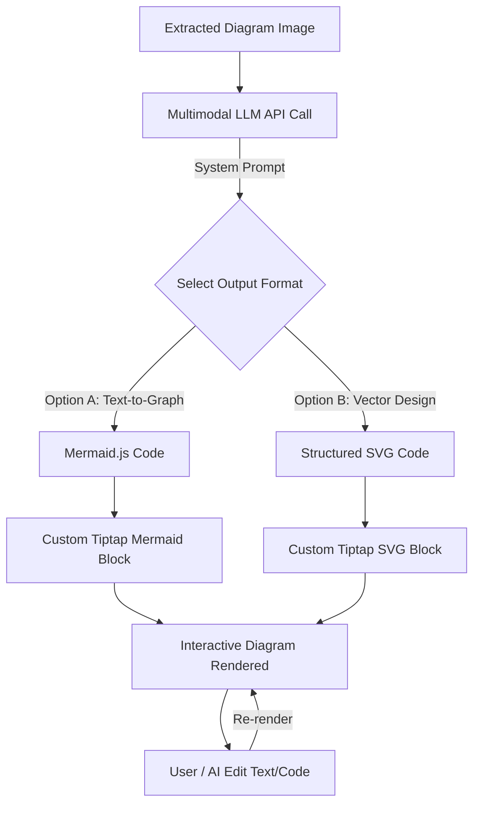
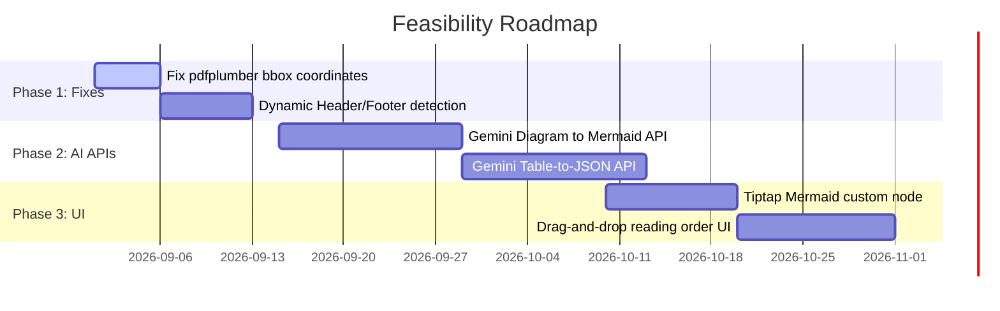

# Feasibility Report: AI Automation & Layout Robustness for PDF Datasheet Composer

---

## Part 1: Small Version (Executive Summary)

This summary provides a high-level feasibility assessment of the four core issues identified in the VelloreSemicon PDF Extractor & Datasheet Composer.

### 1. Project Health & Feasibility Matrix

| Issue | Target Problem | Proposed Solution | Feasibility Status | Estimated Effort |
| :--- | :--- | :--- | :--- | :--- |
| **1. Diagram Automation** | Diagrams are static PNGs; text/labels cannot be edited. | Vision LLM (Gemini 1.5 Pro API) translates images to editable Mermaid/SVG code inside Tiptap. | **High (Green)** | 3 - 4 Weeks |
| **2. Text Order Mismatch** | Text blocks are sorted vertical-first; mixes multi-column text. | Implement recursive XY-Cut sorting algorithms or VLM layout reading order APIs. | **High (Green)** | 1 - 2 Weeks |
| **3. Table Extraction** | Borderless/complex tables fail; pdfplumber coordinates are set to page-size. | Correct pdfplumber bbox detection; implement AI-assisted table visual parsing. | **Medium (Yellow)** | 3 - 5 Weeks |
| **4. Multi-doc Generalization** | Engine overfits to single sample; images and layouts break on others. | Shift from absolute coordinate thresholds to adaptive rules and ML layout parsing. | **Medium (Yellow)** | 4 - 6 Weeks |

---

### 2. Core Recommendations

1. **Adopt Multimodal AI APIs**: Use Gemini 1.5 Pro/Flash APIs to solve the two hardest issues: reconstructing complex tables from raw image crops and compiling diagram images into Mermaid.js or SVG code.
2. **Incorporate Interactive Manual Controls**: Algorithmic extraction is rarely 100% perfect. Support automatic AI extraction with visual corrective tools (e.g., visual table grid adjustments, block re-ordering).
3. **Upgrade Layout Analysis**: Abandon strict Coordinate-based sorting (`y` first, then `x`) in favor of layout-aware parsing libraries (like Recursive XY-Cut) to handle multi-column documents seamlessly.
4. **Establish a Regression Test Suite**: Curate a diverse testing corpus containing 10-15 different manufacturer datasheets to measure parsing accuracy and prevent regression bugs.

---

## Part 2: Large Version (Detailed Architectural Report)

This detailed version provides an in-depth architectural blueprint, code analysis, and design options for each of the four areas.

---

## Section 1: Automating Diagram Modification with AI

### 1.1 The Current Problem
During Phase 2 processing, drawings and vector paths are grouped and rasterized into flat PNG images (e.g., `vector-diagram-p1-0.png`) using PyMuPDF's `page.get_pixmap()`. 
```
[PDF Vector Coordinates] ──> [PyMuPDF Pixmap] ──> [Static PNG Uploaded] ──> [Rendered in Tiptap Editor]
```
Because the output is a static image, the datasheet editor cannot modify labels (e.g., changing "REF" to "VREF"), add pins, or adjust block lines.

### 1.2 Proposed Architecture
We propose replacing static image insertion with **Code-driven Interactive Diagrams** (either SVG or Mermaid.js markup).



### 1.3 Target Formats Comparison

| Feature | Option A: Mermaid.js Code | Option B: Raw SVG Code |
| :--- | :--- | :--- |
| **Code Structure** | Human-readable markdown text (`graph TD ...`) | XML vector coordinates (`<svg><rect ...>`) |
| **Ease of Manual Edit**| Extremely High (simple text editing of node labels) | Medium (requires code editing or custom coordinate UI) |
| **Ease of AI Generation**| Very High (LLMs write Mermaid syntax reliably) | High (LLMs write SVG code but layout can be messy) |
| **Visual Accuracy** | Schematic-like structure; will look clean but not identical. | High visual parity; retains exact original lines and shapes. |
| **Rendering Tool** | Mermaid JS Engine | Browser Native SVG Renderer |

### 1.4 API Integration & Prompting Strategy
When a vector diagram is detected and cropped:
1. Crop the diagram image and send it to **Gemini 1.5 Pro** using the following API payload structure:

```typescript
// POST /api/diagram/convert
import { GoogleGenAI } from "@google/genai";

const ai = new GoogleGenAI({ apiKey: process.env.GEMINI_API_KEY });
const response = await ai.models.generateContent({
  model: 'gemini-1.5-pro',
  contents: [
    {
      inlineData: {
        data: Buffer.from(imageBytes).toString("base64"),
        mimeType: "image/png"
      }
    },
    `Analyze this technical block diagram from a semiconductor datasheet. Reconstruct it exactly as a Mermaid.js flowchart (graph LR or TD). 
     - Detect all boxes, labels, input/output pins, and arrows.
     - Translate all text labels precisely (e.g. VCC, GND, FB).
     - Represent feedback loops correctly.
     - Return ONLY the clean Mermaid markdown code inside a json block.`
  ],
  config: { responseMimeType: "application/json" }
});
```

### 1.5 Editor Integration (Tiptap extension)
Introduce a custom Node view in the Tiptap editor:
- **Renderer**: Uses React to display a split panel showing the live rendered diagram on one side, and a simple text editor/prompt input on the other.
- **AI Modification Route**: Users can type: *"Add an extra output pin labeled VOUT2 connected to the power switch"* and the system calls the API to update the diagram code.

---

## Section 2: Resolving Reading Order Mismatches & Missing Text

### 2.1 The Current Problem
In `worker/app/main.py` (around line 346), native text blocks are sorted using a simple coordinate-based heuristic:
```python
for raw_block in sorted(data.get("blocks", []), key=lambda item: (item.get("bbox", [0, 0, 0, 0])[1], item.get("bbox", [0, 0, 0, 0])[0])):
```
This sorts strictly top-to-bottom (`y`), then left-to-right (`x`). In multi-column layouts, it interleaves lines from both columns, resulting in scrambled text inside the editor.

```
Heuristics (y,x) Output:
[Left Col Line 1] ──> [Right Col Line 1] ──> [Left Col Line 2] ──> [Right Col Line 2] (Scrambled!)
```

### 2.2 Proposed Solution Algorithms
To establish a readable and coherent stream of text, we can use three different approaches:

#### Approach A: Recursive XY-Cut Algorithm (Heuristic-based)
Instead of a simple flat sort, split the page recursively using vertical and horizontal empty white-space channels.
1. Draw horizontal projection profiles of the text coordinates to find column dividers.
2. Segment the page into logical columns (e.g., Left Column, Right Column).
3. Sort blocks top-to-bottom **within** each column, then merge the columns left-to-right.

```python
# Proposed recursive XY-Cut helper concept:
def xy_cut_sort(blocks: list[TextBlock]) -> list[TextBlock]:
    # 1. Cluster blocks into left/right buckets if page is two-column
    # 2. Sort within bucket: key=lambda b: b.boundingBox.y
    # 3. Concatenate: Left Column blocks first, then Right Column blocks.
    ...
```

#### Approach B: Vision-Language Model Layout Parsing (API-based)
Instead of parsing raw PDF coordinates, pass the entire page image or PDF bytes to a layout engine like **Azure Document Intelligence (Read API)** or **Google Document AI (Layout Parser)**.
- These APIs return a structured layout tree with `readingOrder` indicators natively, handling multi-column blocks, callouts, and sidebars without writing manual coordinate thresholds.

#### Approach C: Visual Re-Ordering UI (Manual Override)
Since automated sorting can fail, we must add a quick interactive sidebar inside the review step:
- Display text blocks as cards in a list next to the PDF preview page.
- Allow users to drag-and-drop the blocks to rearrange their order, or merge two adjacent text blocks before committing the datasheet to the composer.

---

## Section 3: Solutions for Table Extraction Issues

### 3.1 The Current Problem
Table extraction is heavily dependent on line rules (lattice) using Camelot and pdfplumber.
1. **Critical Bug in pdfplumber fallback**: The current code maps pdfplumber tables to a page-wide bounding box:
   `boundingBox=BoundingBox(x=0, y=0, width=float(page.width), height=float(page.height))`
   This makes the system think the table takes up the entire page, causing overlap and layout calculations to fail.
2. **Missing Structure**: Borderless tables, tables with merged header cells, and complex footnotes are frequently omitted or corrupted (missing columns/rows).

### 3.2 Proposed Solutions

#### 1. Quick Technical Fix: Resolve pdfplumber Bounding Box
Instead of using `page.extract_tables()`, utilize `page.find_tables()` which yields table objects that hold correct visual coordinates.
```diff
- for table_index, raw_table in enumerate(page.extract_tables() or []):
-     # boundingBox was set to page width/height
+ for table_index, table in enumerate(page.find_tables() or []):
+     bbox = table.bbox # [x0, y0, x1, y1]
+     raw_table = table.extract()
```

#### 2. Visual Table Grid Editor (Manual Corrective Interface)
When automated algorithms fail, allow the user to draw boundary lines on the PDF preview:
- Draw vertical grid lines to define columns.
- Draw horizontal grid lines to define rows.
- The backend then runs target OCR inside the intersections of these drawn cells.

#### 3. AI-Powered Multimodal Table Parser
Pass cropped table images to the Gemini API with instructions to return a clean, structured JSON format of the table.

```typescript
// Prompt for Vision AI Table Parsing
const prompt = `Analyze this table image. Transcribe it into a JSON structure representation with rows and cells.
Ensure cell properties rowSpan and colSpan are correctly calculated for merged headers.
JSON Format:
{
  "rows": [
    [
      { "text": "Header 1", "rowSpan": 1, "colSpan": 2 },
      { "text": "Header 2", "rowSpan": 1, "colSpan": 1 }
    ],
    ...
  ]
}`;
```

---

## Section 4: Multi-document Generalization (Overfitting)

### 4.1 The Current Problem
The engine hardcodes assumptions based on a single template document:
- Header coordinates are hardcoded to the top 12-15% of the page.
- Footer coordinates are hardcoded to the bottom 10-12%.
- Line separators, spacing, and column counts assume a specific page size and margin layout.
When running other documents, headers/footers are incorrectly recognized as body text, images are misplaced, and parsing accuracy collapses.

### 4.2 Proposed Generalization Framework

```
[Raw PDF Input] ──> [Manufacturer Detector] ──> [Dynamic Ruleset Router] ──> [Specialized Parser]
```

1. **Dynamic Margin & Header/Footer Detection**:
   Instead of hardcoding percentages, calculate margins dynamically per PDF file.
   - Run a pass to find the y-coordinate of the highest horizontal line (often the header boundary) and the lowest horizontal line (footer boundary).
   - Track repeating elements across pages. If the exact same text string appears at coordinate `y < 100` on 3 or more pages, mark that exact region as a header dynamically.

2. **Manufacturer Signature Database**:
   Maintain a configuration mapping for common semiconductor vendors:
   ```json
   {
     "VelloreSemicon": {
       "headerPattern": "Vellore Semiconductors",
       "brandingColor": "#0D2B55",
       "doubleColumnThreshold": 0.48
     },
     "GenericVendor": {
       "headerPattern": "Copyright \\d{4} Generic",
       "doubleColumnThreshold": 0.50
     }
   }
   ```
   On upload, read the first page's text. Match it against signatures, select the config, and adjust the parsing rules dynamically.

3. **Continuous Integration Regression Suite**:
   Create a directory `tests/corpus` containing 10-15 test datasheets.
   - Write tests that assert that parsing a new document preserves basic structural elements:
     `expect(extracted.tables.length).toBeGreaterThan(0)`
     `expect(extracted.warnings.length).toBeLessThan(5)`
   - Run this suite on every code commit to ensure tuning for one document does not break another.

---

## Section 5: Implementation Timeline & Costs



### 5.1 Approximate Cost Estimation
*   **Gemini API Usage**: Highly cost-effective. Translating 100 pages of diagrams and tables to code costs roughly **$0.15 - $0.50** in API tokens (using Gemini 1.5 Flash for tables and 1.5 Pro for diagrams).
*   **Development Hours**: Estimated 160-200 engineering hours to complete all phases.
